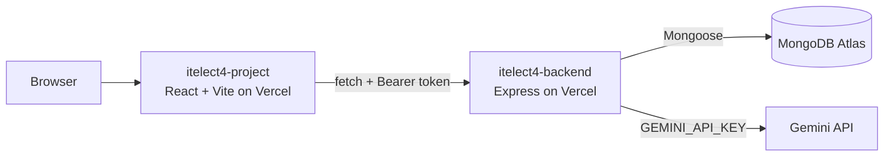

# itelect4-project

The Campus Lost & Found Tracker: React, TypeScript, Vite, Tailwind, shadcn,
TanStack Query and Zustand.

- **Live site:** https://itelect4-project-omega.vercel.app
- **API repo:** https://github.com/OwenLR/itelect4-backend

## What it does

Browse lost and found items, register and log in, submit and track claims on
items, and get AI feedback on how matchable an item description is.

## Architecture

## Run it locally

1. `npm install`
2. `copy .env.example .env` and set `VITE_API_URL=http://localhost:4000`
   (run `itelect4-backend` first).
3. `npm run dev` (http://localhost:5173).
4. `npm test` runs the Vitest tests.

## AI-use disclosure

Used Claude (Anthropic), via the claude.ai chat interface, as a coding
assistant. No other AI tool is used.

Where Claude assisted
- Adapting the class-demo patterns to this Lost and Found app (User / Item / Claim) and
  flagging where a pattern did not fit.
- Troubleshooting setup and deployment errors (tsconfig, PowerShell,
  Vercel, CORS, Atlas).

